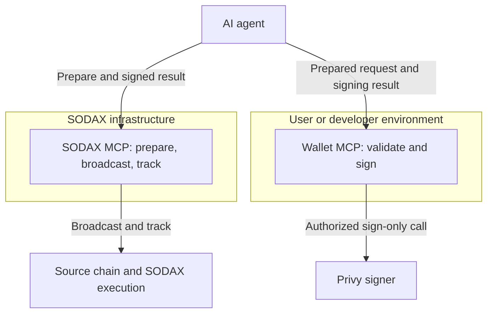

# User-operated Wallet MCP

## Architecture

One repository, two separately started MCP servers:

| Component | Runs where | Responsibility | Authority |
| --- | --- | --- | --- |
| SODAX MCP | SODAX cloud | Prepare, verify signed artifacts, broadcast, submit to backend/relay, track | No wallet signing credentials |
| Wallet MCP | User machine or agent host; later user-owned cloud | Account mapping, permission checks, transaction finalization, Privy sign-only, signature assembly | User-owned Privy authentication and scoped signer authorization |
| Privy | Provider infrastructure | Key management and cryptographic signing | Wallet private keys |
| Agent | User-selected host | Calls both MCPs and forwards opaque requests/results | Never receives secrets in tool arguments/results |

The hosted server never calls the wallet's signing tools. The agent connects to both. A user-owned cloud signer is inside the user's trust boundary, not a shared SODAX service. A signed artifact is sensitive spending authorization even though it contains no private key.

## Existing interfaces and required change

Local snapshots inspected: development `a36489d1fb1fed615f3f3045696c13562119c94a`; bridge feature `a78690e830315236397d1360f2637adf67788745`. They do not establish current production state.

- Swap prepare returns quote ID and ordered unsigned steps.
- Existing swap submit-and-track expects the source tx hash after a wallet broadcasts. Its submission is to SODAX backend/relay.
- Bridge feature uses the same model with bridge ID.
- Non-EVM steps are SDK raw transaction objects serialized into JSON, not uniform ready-to-sign bytes.

Add an optional versioned prepared-signing envelope and a NEW source broadcast tool. Preserve current fields and existing tx-hash-based tools. Update product wording to distinguish broadcasting user-signed transactions from wallet signing.

## Proposed code organization

- `src/index.ts`: existing hosted entry point, never imports wallet startup/config.
- `src/wallet/index.ts`: separate Wallet MCP stdio entry point.
- `src/wallet/tools.ts`: accounts, sign transaction, signing-operation status.
- `src/wallet/config.ts`, `authorization.ts`, `journal.ts`: local account mapping, secret references, policies, durable reservations.
- `src/wallet/providers/privy.ts`: provider sign-only calls.
- `src/wallet/adapters/`: family-specific signing and signature assembly.
- `src/signing/`: public schemas and deterministic codecs, no secret-loading side effects.
- `src/services/transactions/`: hosted prepared-operation storage, signature verification, broadcast and durable journal.

These paths are proposed. Produce separately invocable pinned binaries/build outputs from the same repo. Hosted startup must not register wallet tools or read Privy environment variables. Avoid a public-server flag that accidentally activates wallet signing.

## One-time setup

1. User/developer creates/selects Privy app and wallets outside the agent tool flow.
2. Owner provisions a scoped signer, policies, chain/recipient allowlists, fee/spending limits and approval mode. Keep root policy/ownership administration outside the running signer where provider permissions allow it.
3. Wallet config maps public aliases to provider wallet IDs, expected public keys/addresses, provider secret references, pinned SODAX issuer keys, and trusted RPCs.
4. Start Wallet MCP as the agent host's local stdio subprocess and connect the same agent to hosted SODAX MCP.

No wallet creation, export, policy editing, ownership changes or unrestricted raw-sign tools in v1. Provider app authentication and wallet authorization are separate; verify actual permissions instead of assuming an app secret alone scopes signing.

Default human approval uses a trusted owner UI/OS channel and binds to the exact finalized digest. An agent argument such as `approved: true` grants no authority. Without an approval channel, return approval-required without signing. Autonomous mode is enabled only in owner configuration and requires independently decoded, bounded operations. Refuse opaque contract calls that cannot be matched to policy. Provider raw-hash support does not imply transaction-aware spending enforcement.

## Normal flow

1. Wallet accounts tool returns public source/destination addresses and signing capabilities.
2. Agent calls SODAX swap/bridge prepare with those addresses.
3. SODAX stores the checked operation and returns an issuer-attested prepared request with ordered steps.
4. Wallet validates the request, policy and ownership; finalizes only allowed fee/nonce fields, obtains approval and calls Privy sign-only.
5. Agent passes signed artifact to SODAX source broadcast tool.
6. SODAX revalidates the exact signed transaction, broadcasts and confirms the step. Approval confirmation unlocks the next step; wallet independently checks dependencies on trusted RPC.
7. After source deposit confirmation, agent calls existing swap/bridge submit-and-track with the deposit hash. Destination delivery is tracked separately from source confirmation.

## Chain rollout and gates

| Chain | Wallet adapter | Activation gate |
| --- | --- | --- |
| EVM | Finalize nonce/gas/fees within constraints; return signed serialized EOA transaction | First slice; sequential approvals, nonce lock and exact calldata validation |
| Solana | Preserve message/blockhash/fee payer and attach signatures | Versioned messages, signer set, expiry verified |
| Stellar | Network-aware hash and signed XDR envelope assembly | Sequence/time bounds and Soroban authorization verified |
| Sui | Intent-aware hashing and serialized signature with public key/scheme | PTB/MoveCall compatibility; provider hashing/schema discrepancy resolved |
| NEAR | Borsh, SHA-256 and SignedTransaction assembly | Access-key nonce/recent block; partial receipt failures handled |
| Tron | Structured sign-only method or verified raw-sign conversion | Actual provider/node wire format AND SODAX source validation |
| TON | Wallet contract/version/workchain, cell digest, seqno, expiry, signed external message | StateInit/deployment and SODAX source validation |

Injective and other families stay unsupported until explicitly implemented. Wallet chain coverage is not SODAX source execution coverage. EIP-5792 batches, user operations/smart accounts, sponsorship, generic messages/typed data and automatic replacements are outside v1; existing wallet-broadcast paths remain available.

## Persistence and deployment

Local Wallet MCP uses a protected durable journal (for example SQLite); multi-worker user-owned cloud requires a shared transactional database/lock. SODAX prepared and broadcast records must also be durable before reliable cloud rollout; RAM-only quote caches are insufficient.

Reserve spending exposure before provider signing. Signed results may be broadcast outside SODAX, so reservations cannot be released merely on disconnect or broadcast failure; require confirmed consumption or proven artifact expiry/invalidity. Deduplicate approval/deposit exposure correctly. Store recoverable signed artifacts encrypted and never put them, signatures or credentials in logs/analytics.

User-owned HTTP deployment additionally requires authenticated access, tenant/account isolation and private secret management. Local stdio is the default to avoid an unnecessary public signing endpoint.

## Implementation and validation

1. Define envelopes/codecs and durable records without changing existing tool signatures.
2. EVM accounts → prepare → sign-only → verified broadcast → existing tracking.
3. Validate with local-chain adversarial cases and provider fixtures; real-funds canary execution is separately authorized.
4. Add families independently and advertise only tested capabilities.

Critical checks: wrong owner/account, altered recipient/calldata/amount, expired/forged envelope, wrong-network signature, independent wallet validation, approval order, concurrent budget reservations, restart/provider timeout, RPC timeout without duplicate deposit, and destination completion versus source confirmation.

Detailed schemas and recovery are in `plan-contract.md`; evidence and limits are in `process.md`.
